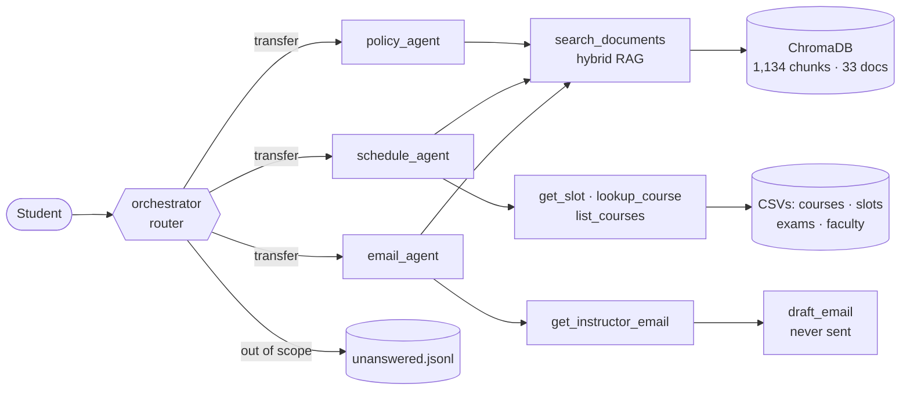

# Academic Helpdesk Agent · IIT Jodhpur

A multi-agent helpdesk for IIT Jodhpur students. It answers questions about programmes, courses, the time table and academic rules, cites a document for every answer, drafts emails to instructors, and says **"I don't know"** instead of guessing, logging the question for a human. It runs fully locally on a 16 GB laptop with Google ADK, Ollama (Qwen3 8B / Llama 3.1 8B) and ChromaDB.

[Report (PDF)](report/report.pdf) · [Technical deep dive](docs/TECHNICAL.md) · [Problem statement](docs/PROBLEM_STATEMENT.md) · [Build log](docs/PROGRESS_LOG.md)


## What it does

- **Answers with citations.** Rules, curricula, slots, exam dates and course counts, each ending with `Source: <document, page>`.
- **Uses the newest rule.** An amendment register drops passages that a later circular replaced (2024 attendance circular over the 2019 regulations).
- **Drafts emails, never sends them.** It looks up the instructor, saves a draft to `drafts/`, and suggests the right course code for a wrong one (*CSL7570 → did you mean CSL7650?*).
- **Asks when the answer depends on the student.** For credit requirements, it asks for the programme and year of joining.
- **Refuses and hands off.** Out-of-scope questions get a fixed refusal and are logged to `logs/unanswered.jsonl`.
- **Single or multi-agent:** one agent with 7 tools, or a router that hands each request to a policy, schedule or email specialist.
- **Web UI** showing a live agent trace, answer cards (time table, email draft, rule history), the cited page, a document graph and the hand-off queue.

## How it works



- **Data:** 33 real institute documents (29 current, 4 older versions kept to test that the newer rule wins). Spreadsheets become CSVs: 821 course offerings, slots, exam schedule, and 312 instructors with dummy emails.
- **Retrieval:** chunks with a title/date/page header, `nomic-embed-text` embeddings, and dense + BM25 search merged by reciprocal rank fusion. Amended passages are dropped and superseded documents down-weighted.
- **Agents:** Google ADK on `LiteLlm → Ollama`. Deterministic checks log every refusal, route empty router replies, and send a request to the email agent only when it asks for an email.

## Results

30 questions × 2 models × 2 modes × 3 repeats, every failure reviewed by hand ([summary](eval/results/summary.md), [report](report/report.pdf)):

| Config | Accuracy | Grounded | Correct refusals | Routing | Changed across runs | Mean latency |
|---|---|---|---|---|---|---|
| single · qwen3:8b | **87%** | 70% | 100% | – | **0/31** | **9.5 s** |
| multi · qwen3:8b | 84% | **78%** | 100% | 94% | **0/31** | 12.2 s |
| single · llama3.1:8b | 65% | 46% | 100% | – | 8/31 | 14.2 s |
| multi · llama3.1:8b | 69% | 62% | 100% | 94% | 3/31 | 13.3 s |

The model matters more than the architecture, multi-agent mode improves grounding, and every out-of-scope question was refused and logged.

## Quick start

Needs macOS/Linux with 16 GB RAM, [Ollama](https://ollama.com) and Python 3.12 ([uv](https://docs.astral.sh/uv/) or pip). Setup takes about 15–30 minutes, mostly the model download.

```bash
ollama pull qwen3:8b && ollama pull nomic-embed-text      # ~5.5 GB; add llama3.1:8b to compare models
uv venv --python 3.12 .venv && uv pip install -p .venv -r requirements.txt
cp .env.example .env                                       # defaults work
.venv/bin/python -m helpdesk.ingest --reset                # build the vector index (~40 s)
```

Run it:

```bash
.venv/bin/python -m helpdesk.web.server                    # web UI at http://localhost:8000
.venv/bin/python -m helpdesk.cli --mode multi              # terminal chat (/new, /unanswered, /quit)
.venv/bin/python -m helpdesk.cli --ask "What is the slot for Autonomous Systems?"
.venv/bin/adk web agent                                    # ADK dev UI
```

Mode and model default to `.env` (`HELPDESK_MODE`, `HELPDESK_MODEL`); the web UI can switch modes in the page.

## Web UI

| Multi-agent trace, refusal ticket, hand-off queue | Course card and the chat's document graph |
|---|---|
|  |  |

- **Live trace** of router hand-offs and tool calls while the model works.
- **Cards** built from tool results: course time table with exam countdown, editable email draft, course list, did-you-mean buttons, refusal ticket, and rule history.
- **Sources** open at the cited page, and a **graph** (Quartz-style) shows the documents behind each answer.
- An **Unanswered** tab lists the hand-off queue.
- It works on phones and tablets.

How it is built: [TECHNICAL.md §9.1](docs/TECHNICAL.md#91-web-ui-helpdeskweb).

## Evaluate and test

```bash
.venv/bin/python eval/run_eval.py                          # 2 models × 2 modes × 3 repeats (~80 min)
.venv/bin/python eval/score.py                             # → eval/results/summary.md, review.md
.venv/bin/python eval/check_retrieval.py                   # retrieval only (hit@k)
.venv/bin/python -m pytest -q tests                        # 73 unit tests
```

The question set is in [`eval/questions.jsonl`](eval/questions.jsonl). To rebuild the data from the raw documents, run `scripts/ocr_scanned.py` (needs `tesseract`) and then `scripts/build_csvs.py` before ingesting.

## Repository layout

```
docs/          problem statement · plan · progress log · technical deep dive · img/
data/          raw/ (33 documents) · ocr/ · csv/ · manifest.csv · amendments.csv · index/ (generated)
scripts/       data pipeline: OCR, spreadsheets → CSVs
helpdesk/      config · llm · prompts · ingest · rag · runner · cli
  tools/       retrieval · timetable · faculty · email_draft · unanswered
  agents/      single_agent · multi_agent · guards
  web/         FastAPI server · static page
agent/         ADK dev-UI entry point
eval/          questions · run_eval · score · check_retrieval · results/
report/        report.tex → report.pdf
tests/         unit tests
```

## Data and privacy

Public documents come from iitj.ac.in. Current-semester time tables and course lists come from Registration and Examination Cell circulars sent to students. Instructor names are kept as published, but every email address the agent can see or draft to is a dummy (`first.last@iitj.example`), and other addresses are masked at ingestion. No sheets listing other students were collected. Drafts are never sent.

## License

MIT, see [LICENSE](LICENSE).
