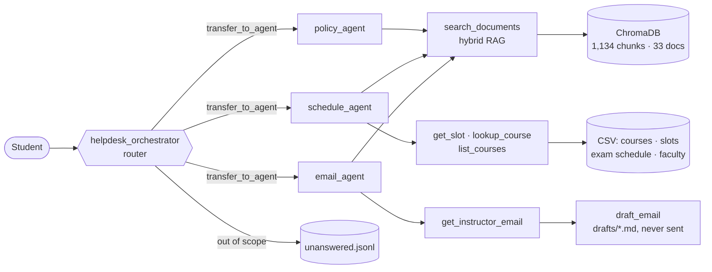
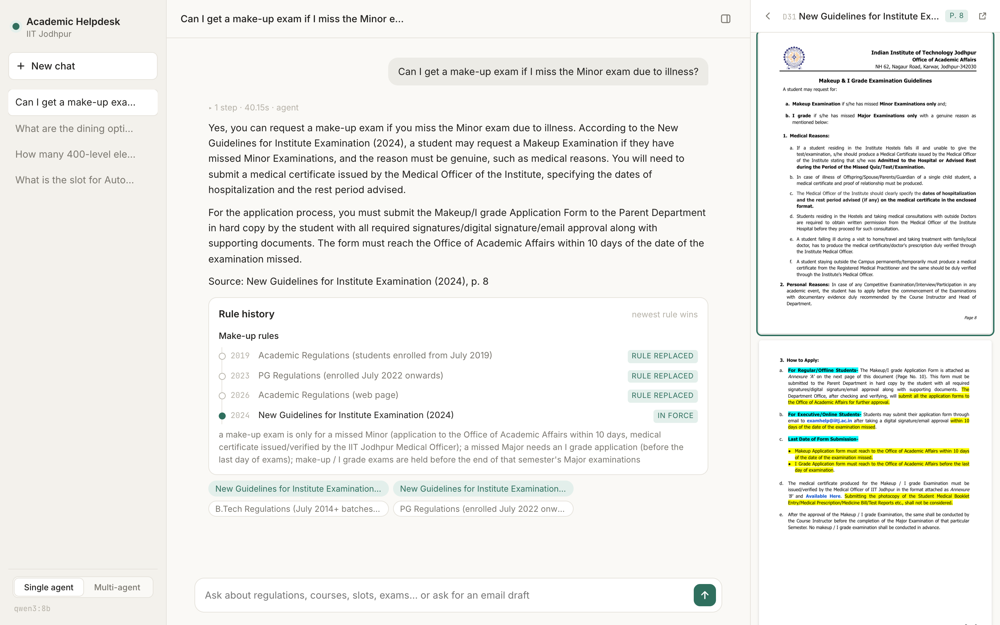
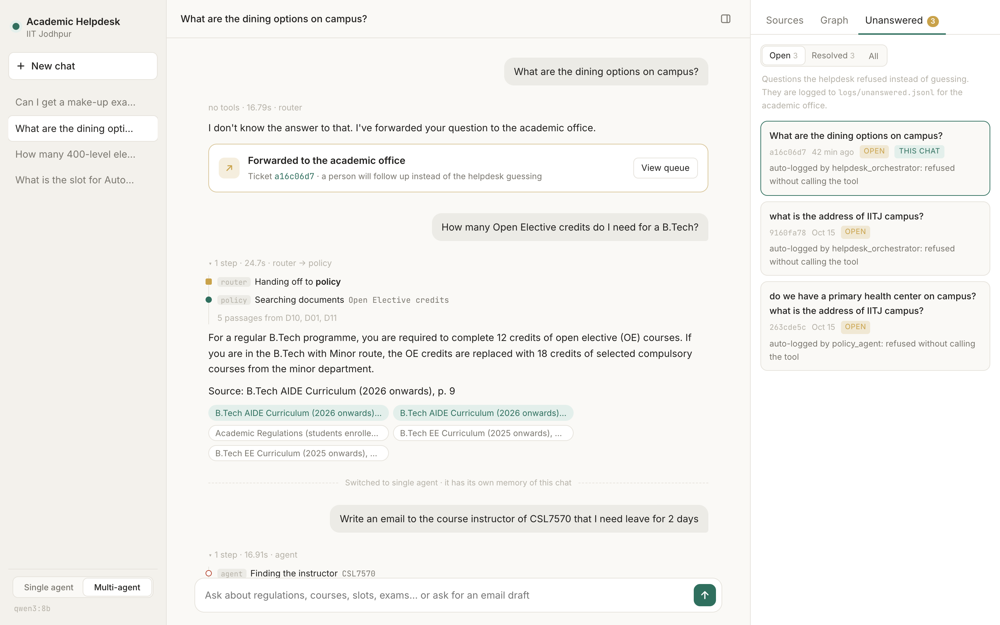
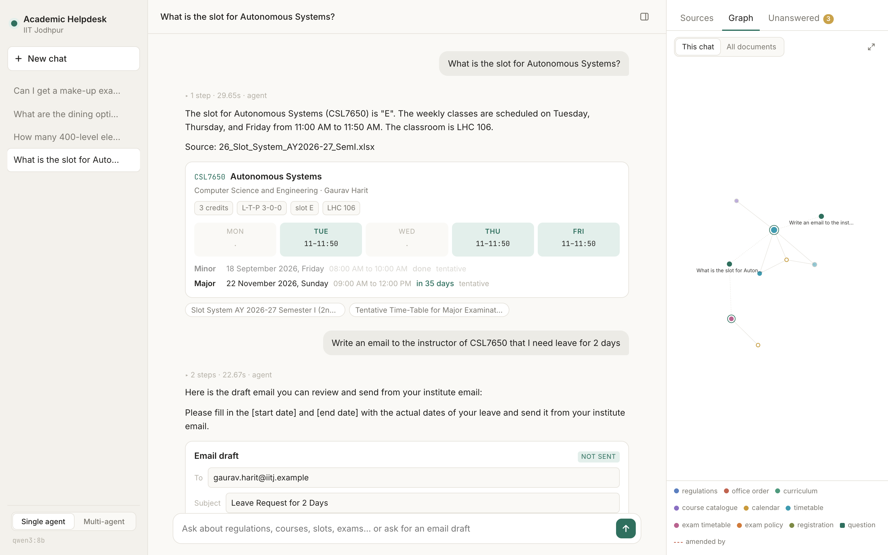
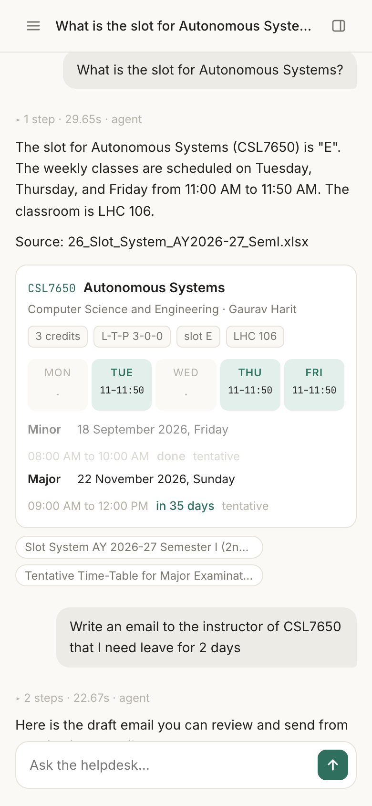

# Academic Helpdesk Agent — IIT Jodhpur

A multi-agent academic helpdesk that answers questions about IIT Jodhpur's programmes, courses, time table and academic rules, drafts emails to course instructors, cites the document behind every answer, and says **"I don't know"** (and logs the question for a human) instead of guessing. Runs fully locally on a 16 GB laptop: Google ADK + Ollama (Qwen3 8B / Llama 3.1 8B) + ChromaDB.

> **Deep dive:** [docs/TECHNICAL.md](docs/TECHNICAL.md) · **Report (LaTeX/PDF):** [report/report.pdf](report/report.pdf) · **Build log:** [docs/PROGRESS_LOG.md](docs/PROGRESS_LOG.md) · **Plan:** [docs/PLAN.md](docs/PLAN.md)

---

## Problem statement

*(Course assignment — full text in [docs/PROBLEM_STATEMENT.md](docs/PROBLEM_STATEMENT.md).)*

Design a **multi-agent Academic Helpdesk Agent** that can

- answer questions about academic programmes, course contents, and rules and regulations, e.g. *"What is the attendance requirement to sit in the Major exam?"*, *"What is the slot for Autonomous Systems?"*, *"How many 400-level electives has the Humanities department floated this semester?"*, *"How many Open Elective credits do I need for a B.Tech?"*;
- **draft an email** to a course instructor (sick leave, make-up exam permission) — *"Write an email to the course instructor of CSL7570 that I need leave for 2 days"*;
- **refuse** anything else (*"What are the dining options on campus?"*) rather than guess, and **log** unanswered questions for a human;
- **cite** the source document of every answer.

Constraints: 20–30 real documents (personal data replaced by dummy values), RAG with a local embedding model and vector store, tools for search / time-table lookup / instructor email / email drafts, Google ADK with Ollama-hosted 8B models via LiteLLM, runnable on 16 GB RAM. Start with a single agent, then extend to an orchestrator with **policy**, **schedule** and **email** agents, and evaluate 20–30 prompts for accuracy, groundedness and correct refusals across models and repeated runs.

## Solution



- **Data:** 33 real IIT Jodhpur documents — academic regulations, attendance/exam circulars, B.Tech/M.Tech curricula, course catalogues, academic calendars, the Semester I 2026-27 course list, slot system, classroom allocation and major-exam time table, IH course lists, examination guidelines. Spreadsheets are turned into structured CSVs (821 course offerings, slot timings, minor/major exam schedule, 312 instructors with **dummy** emails).
- **RAG:** documents are chunked with a title/date/page header, embedded with `nomic-embed-text`, stored in ChromaDB, and searched with **hybrid retrieval** (dense + BM25, reciprocal-rank fusion). Superseded documents are down-weighted and passages replaced by a later circular are dropped (an *amendment register*).
- **Agents:** a single-agent baseline and a multi-agent version (router + 3 specialists) built with Google ADK on `LiteLlm → Ollama`. Deterministic guards make sure every refusal is logged.
- **Evaluation:** 30 prompts × 2 models × 2 modes × 3 repeats (372 turns), scored for accuracy, groundedness, refusals, routing and run-to-run consistency, with manual review of every failure.

## Features

| | |
|---|---|
| **Grounded answers with citations** | Every answer ends with `Source: <document title, page/sheet>` taken from a tool result. |
| **Newest rule wins** | Amendment register + superseded-document weighting: the 2024 attendance circular beats the 2019 regulations; the 2024 exam guidelines beat the old make-up rules. |
| **Time table lookups** | Slot, weekly class times, classroom, instructor, minor/major exam date of any course; counts of courses floated by department/level ("Humanities" = Institute Humanities, incl. IH courses taught by AIDE). |
| **Email drafts** | Looks up the instructor, drafts a formal email, saves it to `drafts/` for the student to review — **never sends**. Unknown course codes get *"Did you mean CSL7650 (Autonomous Systems)?"* instead of a guess. |
| **Clarifies when the answer depends on the student** | Credit requirements differ by programme and batch → asks *"Which B.Tech branch and which year did you join?"*, then answers from that curriculum. |
| **Honest refusals + human hand-off** | Out-of-scope questions get *"I don't know the answer to that. I've forwarded your question to the academic office."* and are logged to `logs/unanswered.jsonl` (`/unanswered` in the CLI lists them). |
| **Single- or multi-agent** | `--mode single` (one agent, 7 tools) or `--mode multi` (router → policy / schedule / email specialists). |
| **Swappable local models** | Any Ollama chat model via `HELPDESK_MODEL` (tested: `qwen3:8b`, `llama3.1:8b`). |
| **Web UI** | Local chat page with a live agent trace, answer cards (time table, email draft, course list), rule history, cited-page preview, a document graph and the unanswered queue — see [Web UI](#web-ui). |
| **Reproducible evaluation** | `eval/run_eval.py` + `eval/score.py` with per-run isolation, resumable runs, review sheet and summary tables. |

## Results at a glance

30 prompts (31 turns) × 3 repeats per configuration, after manual review ([full tables](eval/results/summary.md), [report](report/report.pdf)):

| Config | Accuracy | Grounded | Correct refusals | False refusals | Routing | Answers changed across runs | Mean latency |
|---|---|---|---|---|---|---|---|
| single · qwen3:8b | **87%** | 70% | 100% | 4% | – | **0/31** | **9.5 s** |
| multi · qwen3:8b | 84% | **78%** | 100% | 8% | 94% | **0/31** | 12.2 s |
| single · llama3.1:8b | 65% | 46% | 100% | 1% | – | 8/31 | 14.2 s |
| multi · llama3.1:8b | 69% | 62% | 100% | 0% | 94% | 3/31 | 13.3 s |

Model choice matters more than architecture; multi-agent improves groundedness for both models; out-of-scope refusals are 100% correct and logged in every configuration.

## Quick start

**Prerequisites:** macOS/Linux with 16 GB RAM, [Ollama](https://ollama.com), Python 3.12 (with [uv](https://docs.astral.sh/uv/) or pip).

```bash
# 1. models (≈10 GB)
ollama pull qwen3:8b && ollama pull llama3.1:8b && ollama pull nomic-embed-text

# 2. environment
uv venv --python 3.12 .venv && uv pip install -p .venv -r requirements.txt
cp .env.example .env            # model, mode, paths; defaults work

# 3. build the vector index (≈40 s) — CSVs and OCR text are already committed
.venv/bin/python -m helpdesk.ingest --reset
```

**Chat in the terminal**

```bash
.venv/bin/python -m helpdesk.cli                     # mode/model from .env (default: single · qwen3:8b)
.venv/bin/python -m helpdesk.cli --mode multi
.venv/bin/python -m helpdesk.cli --ask "What is the slot for the course Autonomous Systems?"
```

REPL commands: `/new` (new session), `/unanswered` (questions forwarded to a human), `/quit`.

**Web UI** — see [Web UI](#web-ui) below

```bash
.venv/bin/python -m helpdesk.web.server              # http://localhost:8000 (--mode, --model, --port)
```

**ADK dev UI** (mode/model from `.env`, e.g. `HELPDESK_MODE=multi`)

```bash
.venv/bin/adk web agent
```

**Example**

```
you> What is the attendance requirement to sit in the Major exam?
  → policy_agent: search_documents({"query": "attendance requirement to sit in the Major exam"})
To sit in the Major exam a student must have at least 75% attendance in the course. If attendance
falls below 75% without a valid reason, the instructor can recommend de-registration from the course.
Source: Circular 51: Amendment in the Attendance Policy, pp. 1-2

you> Write an email to the course instructor of CSL7570 that I need leave for 2 days
The course CSL7570 is not offered in Semester I, AY 2026-27. Did you mean CSL7650 (Autonomous Systems),
CSL7560 (Advanced Data Structure and Algorithms), or CSL7350 (Selected Topics in AI)?

you> What are the available dining options on the campus?
I don't know the answer to that. I've forwarded your question to the academic office.
```

**Rebuild the data from the raw documents (optional)**

```bash
.venv/bin/python scripts/ocr_scanned.py     # needs `tesseract`; OCR text for scanned PDFs → data/ocr/
.venv/bin/python scripts/build_csvs.py      # spreadsheets → data/csv/*.csv
.venv/bin/python -m helpdesk.ingest --reset # documents → data/index/
```

**Evaluate**

```bash
.venv/bin/python eval/run_eval.py                     # 2 models × 2 modes × 3 repeats (~80 min)
.venv/bin/python eval/run_eval.py --models ollama_chat/qwen3:8b --modes multi --repeats 1 --only P01 E01
.venv/bin/python eval/score.py                        # → eval/results/summary.md, summary.csv, review.md
.venv/bin/python eval/check_retrieval.py              # retrieval-only check (hit@k, distance threshold)
.venv/bin/python -m pytest -q tests                   # 35 unit tests; one needs the index + Ollama (skipped otherwise)
```

## Web UI

A small FastAPI server (`helpdesk/web/`) in front of the same agents, with a single static page (no build step). Chats are kept in the browser's local storage; the server only holds the agent sessions.



- **Live agent trace.** While the model works, each step streams in (server-sent events): router hand-offs, tool calls with their arguments, and a one-line result (*"5 passages from D31, D04, D05"*, *"CSL7650 Autonomous Systems · slot E"*). Afterwards it folds into a summary line: steps · seconds · route.
- **Single / multi-agent toggle** in the sidebar. Each mode keeps its own conversation memory; the chat shows a divider where you switch.
- **Answer cards** built from the tool results, not from the model's text:
  - *Course* — slot, room, instructor, a Mon–Fri grid of class times and the minor/major exams with a countdown.
  - *Email draft* — editable To / Subject / Body with Copy and Open-in-mail-app; marked **not sent**.
  - *Course list* — a filterable table for "how many courses…" questions.
  - *Did you mean* — the suggested course codes as buttons; *clarify* — programme and year pickers when the agent asks for them.
  - *Forwarded* — a refusal shows its ticket id from `logs/unanswered.jsonl`.
  - *Rule history* — when the answer cites a document that replaced older rules (or cites a superseded one), a timeline from `data/amendments.csv` and the manifest: *2019 Regulations → 2024 Examination Guidelines (in force)*.
- **Sources and page preview.** Every document a tool returned, cited ones first, with the retrieved passages. Clicking a source opens it in the side panel at the cited page (PDFs are drawn with PDF.js so this also works on phones); saved web pages and text files render too, spreadsheets offer a download.
- **Document graph** (in the style of [Quartz](https://quartz.jzhao.xyz/)'s graph view): the 33 documents coloured by category, linked to category tags and by "amended by" edges; each question in the chat becomes a node linked to the documents behind its answer. While a question is being answered, the documents a search returns light up as they arrive. *This chat* shows the local neighbourhood, *All documents* everything; hover to highlight, scroll to zoom, click a document to preview it.
- **Unanswered tab** — the hand-off queue (open / resolved), with this chat's tickets highlighted.
- **Responsive** — three columns on a laptop; on tablets and phones the chat list and the panel slide over the chat.

| Multi-agent trace, refusal ticket and the hand-off queue | Course card and the chat's document graph |
|---|---|
|  |  |



API (used by the page, handy for scripting): `POST /api/chat` (one JSON answer) · `POST /api/chat/stream` (server-sent events: `start`, `call`, `result`, `done`) · `GET /api/graph` · `GET /api/unanswered` · `GET /api/doc/{doc_id}` · `GET /api/info`. Request body: `{"message": "...", "session_id": null, "mode": "multi"}`.

## Repository layout

```
docs/          PROBLEM_STATEMENT.md · PLAN.md · PROGRESS_LOG.md · TECHNICAL.md · img/ (screenshots)
data/
  raw/         33 source documents (PDF / XLSX / HTML / TXT)
  ocr/ csv/    derived: OCR text · courses, slots, exam_schedule, faculty (dummy emails)
  index/       ChromaDB vector store (generated, git-ignored)
  manifest.csv · amendments.csv
scripts/       data pipeline: ocr_scanned.py → build_csvs.py
helpdesk/      config · llm · prompts · ingest · rag · runner · cli
  tools/       retrieval · timetable · faculty · email_draft · unanswered
  agents/      single_agent · multi_agent · guards
  web/         server.py (FastAPI) · static/ (index.html · app.js · graph.js · style.css)
agent/         ADK dev-UI entry point
eval/          questions.jsonl (build_questions.py) · run_eval.py · score.py · check_retrieval.py
  results/     summary.md/.csv · review.md · scored.jsonl · runs/<mode>__<model>__r<k>/
report/        report.tex → report.pdf
tests/         unit tests for ingestion, retrieval, tools, guards, scoring, web UI
```

## Data and privacy

Public documents come from iitj.ac.in; current-semester time tables, course lists and IH lists come from the author's institute mailbox (Registration Cell / Examination Cell circulars). Instructor **names** are kept as published; **every email address the agent can see or draft to is a dummy** (`firstname.lastname@iitj.example`, a reserved domain), and other email addresses in the documents are masked at ingestion. Sheets with other students' names/roll numbers were not collected. Drafts are only written to disk, never sent.

## License

MIT — see [LICENSE](LICENSE).
