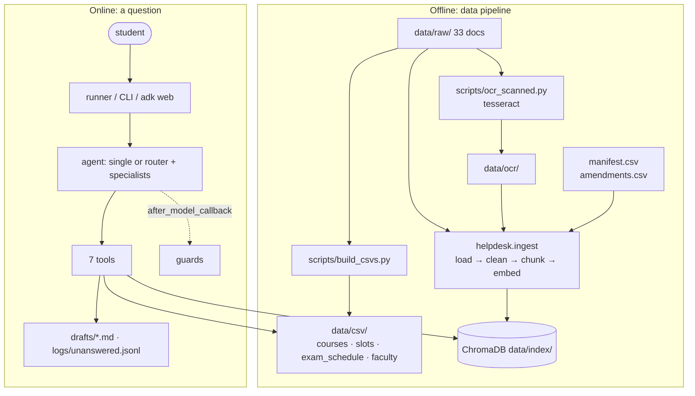

# Technical Deep Dive

How the Academic Helpdesk Agent is built, why it is built that way, and what the evaluation showed. For setup and usage see the [README](../README.md); for the chronological record of every decision (including dead ends) see [PROGRESS_LOG.md](PROGRESS_LOG.md).

**Contents**
1. [Architecture](#1-architecture)
2. [Data pipeline](#2-data-pipeline)
3. [Ingestion](#3-ingestion)
4. [Retrieval](#4-retrieval)
5. [Tools](#5-tools)
6. [LLM configuration](#6-llm-configuration)
7. [Prompts](#7-prompts)
8. [Agents](#8-agents)
9. [Runtime: runner, CLI, ADK web](#9-runtime-runner-cli-adk-web)
10. [Evaluation methodology](#10-evaluation-methodology)
11. [Results and analysis](#11-results-and-analysis)
12. [Design decisions and lessons](#12-design-decisions-and-lessons)
13. [Limitations and future work](#13-limitations-and-future-work)
14. [Configuration reference](#14-configuration-reference)
15. [Post-evaluation changes](#15-post-evaluation-changes)

---

## 1. Architecture

| Layer | Implementation |
|---|---|
| Agent framework | Google ADK 2.12 (`LlmAgent`, `sub_agents`, `transfer_to_agent`, callbacks, `InMemoryRunner`) |
| LLM | Ollama-hosted `qwen3:8b` (default) / `llama3.1:8b`, via ADK's `LiteLlm` connector (`ollama_chat/…`) |
| Embeddings | `nomic-embed-text` (768-d) via Ollama, with `search_document:` / `search_query:` prefixes |
| Vector store | ChromaDB persistent client, cosine space |
| Sparse retrieval | In-house BM25 (~30 lines), fused with dense results by RRF |
| Structured data | pandas over CSVs built from the institute spreadsheets |
| Package | `helpdesk/` (~2.7k lines incl. scripts, eval and tests) |

**Request flow (multi mode).** The orchestrator either calls `transfer_to_agent(policy_agent | schedule_agent | email_agent)` or, for out-of-scope requests, calls `log_unanswered_question` and replies with the fixed refusal sentence. The chosen specialist calls its tools and answers with a `Source:` line. The next student message goes back to the orchestrator (specialists cannot keep control — §8.3), so multi-turn conversations are re-routed turn by turn.

---

## 2. Data pipeline

### 2.1 Sources (33 documents, `data/manifest.csv`)

| Category | # | Examples |
|---|---|---|
| Regulations | 5 | Academic Regulations 2019 (PDF + web page), B.Tech Regulations 2018, PG Regulations 2022+, MS by Research 2023 |
| Office orders / circulars | 5 | **Circular 51** (attendance, 2024), **Circular 52** (exam policy, 2024), M.Tech continuation norms, joint-programme circular, announcements page |
| Curricula | 5 | B.Tech CSE (batches before 2026), AIDE 2026+, EE 2025+, M.Tech AI, M.Tech CSE |
| Course catalogues | 8 | CSE course details, HSS concept note, institute common courses, HSS UG courses page, IH2/IH3 syllabi, IH course lists (current + previous year) |
| Calendars | 3 | AY 2026-27, AY 2025-26, Summer 2026 |
| Time tables | 3 | Finalized courses list Sem I 2026-27, slot system + classroom allocation + minor-exam schedule, 2023 first-year slot chart |
| Exam | 2 | Major-exam time table Sem I 2026-27, New Guidelines for Institute Examination (2024) |
| Registration | 2 | UG registration guidelines page, Circular 2283 |

24 are public (iitj.ac.in, fetched with `curl -k` because the site's TLS chain is broken); 9 come from the author's institute mailbox (Registration Cell and Examination Cell emails: course list, slot system, IH lists, major-exam time table, exam guidelines). Each manifest row has `doc_id, filename, title, category, source, date, status, text_layer, notes`. **`status`** is `current` (29) or `superseded` (4: 2018 B.Tech regulations, 2025-26 calendar, 2023 slot chart, previous year's IH list).

### 2.2 OCR (`scripts/ocr_scanned.py`)
Three circulars are scans without a text layer. Pages are rendered at 300 dpi with PyMuPDF and read with the `tesseract` CLI; page breaks are kept as form feeds so citations keep page numbers.

### 2.3 Structured CSVs (`scripts/build_csvs.py`)
- **`courses.csv` (821 rows).** Built from the **Classroom Allocation** sheet first (738 rows / 612 codes; uniform columns, full instructor names, final slots and rooms), then filled from the 20-tab *Finalized courses list* (category / offered-for, plus 83 courses missing from the allocation). The finalized list's tabs all have different headers, so columns are mapped by header-name patterns. Derived columns: `level` (first digit of the course number × 100), `slot_code` (`G (Wed)` → `G`), `department_code` (keyword map), and **`ih_group`** (IH2/IH3, taken from the official IH course list D33) so that "Humanities" can mean *Institute Humanities* including IH courses taught by AIDE.
- **`slots.csv` (61 rows):** slot letter → day + time, parsed from the slot-system grid (theory and lab columns).
- **`exam_schedule.csv` (89 rows):** minor (45) and major (44) exam grid → (date, time window, slot); holidays and free slots dropped.
- **`faculty.csv` (312):** unique instructors with **dummy** emails `first.last@iitj.example` (reserved TLD → cannot be delivered) and the course codes they teach.

### 2.4 Amendment register (`data/amendments.csv`)
Rules change: Circular 51 (2024) replaced the 2019 attendance rule; the 2024 Examination Guidelines replaced the 2019/2022 make-up rules — but the old text is still in the regulations PDFs, the web page and the PG regulations. Each row `(doc_id, match, superseded_by, note)` marks the chunks whose text contains `match` as **`amended`**; the retriever drops them and their header names the replacement. 8 rows cover D01/D21 (attendance §4.1.9, make-up §8) and D05 (make-up).

---

## 3. Ingestion

`python -m helpdesk.ingest [--reset]` → 1,134 chunks from 33 documents in ≈40 s.

- **Loaders:** PDF (PyMuPDF per page, or the OCR text), HTML (a small `HTMLParser` that drops nav/script/header/footer and **renders tables as `a | b | c` rows** — without this the OE-credit table lost its structure), XLSX (one "page" per sheet, rows as pipes), TXT/MD.
- **Privacy at ingestion:** sheets with staff contact data are skipped; any email that is not an office mailbox (`examhelp@`, `registration@`, …) is replaced by `[faculty email: use lookup]`, so the only addresses the model can see are the dummy ones from `faculty.csv`.
- **Chunking:** ~1,800 characters (~450 tokens) with 250-character overlap, splitting on paragraph → line → sentence boundaries. **Documents ≤ 3,200 characters are one chunk** (circulars keep the "existing policy" and the "revised policy" together; citations show `pp. 1-2`).
- **Contextual header** on every chunk: `[<title> | <date> | page N | SUPERSEDED by … (if amended)]`. Chunks rarely name their own document ("IH2", "PG", "Circular 51"); the header gives both the embedding and BM25 something to match.
- **Metadata:** `doc_id, title, filename, category, date, status (current | superseded | amended), source, page, chunk`. Chunk IDs are stable hashes; re-ingesting a document deletes its old chunks first.

---

## 4. Retrieval

`helpdesk/rag.py::search(query, k=5, max_distance=0.35, document="")`

1. **Dense:** Chroma top-30 by cosine distance on `search_query:`-prefixed embeddings.
2. **Sparse:** BM25 top-30 over the same chunks. The tokenizer keeps course codes (`lal4070`), drops stopwords, and **normalises spelling variants** (`make-up` / `make up` → `makeup`) — the exam guidelines spell "Makeup", and before this fix they never reached the top 5 for "make-up exam".
3. **Reciprocal rank fusion** (k = 60).
4. **Status handling:** `amended` chunks are removed; `superseded` documents are kept at **0.5×** weight (sometimes they are the only source).
5. **Diversity:** at most **2 chunks per document** so one long curriculum cannot fill all slots.
6. **Refusal guard:** if the best *dense* distance > 0.35 → `found: false`, no results.
7. **Scoped search:** `document="CSE Curriculum"` restricts to documents whose title contains all the words; the distance guard and per-document cap are skipped inside a chosen document.

**Retrieval-only check** (`eval/check_retrieval.py`, 19 in-scope questions with acceptable source docs + 8 out-of-scope):

| Version | hit@1 | hit@5 |
|---|---|---|
| Dense only | 9/18 | 17/18 |
| + BM25 (RRF) | 9/18 | 15/18 |
| + contextual chunk headers | 10/18 | 16/18 |
| + superseded 0.5× | 11/18 | 16/18 |
| + whole short docs, amended filtering, per-doc cap, spelling normalisation (final, 19 questions) | **12/19** | **18/19** |

Best-match distances overlap: in-scope 0.150–0.278, out-of-scope 0.264–0.430 ("restaurant near IIT Jodhpur" scores 0.26 against the regulations page). The 0.35 threshold keeps every in-scope question but rejects only 4/8 out-of-scope ones, so **refusals cannot rely on the distance guard**; the prompt and the router do most of that work.

---

## 5. Tools

Plain Python functions with type hints and docstrings (ADK derives the schema from them); every result carries a `source` for citation.

| Tool | Purpose | Notes |
|---|---|---|
| `search_documents(query, top_k=5, document="")` | Hybrid RAG search | Returns `found`, passages with `citation`, `date`, `status`. Specialists other than policy get `search_documents_all` — the same tool name **without** `document` (they misused the filter) |
| `lookup_course(course)` | Course by code (`csl 7650`, `CSL-7650`) or name | Sections merged; unknown codes return **"did you mean"** suggestions (closest codes, same department prefix first → CSL7570 suggests CSL7650 first) |
| `get_slot(course)` | Slot, weekly times, classroom, instructors, minor/major exam date | Joins `courses`, `slots`, `exam_schedule` on `slot_code` |
| `list_courses(department, level)` | Count + list of courses floated | Department aliases; "Humanities"/"HSS"/"IH" = SoLA + IH-tagged courses. The original `course_type` parameter was **removed** — models kept passing "Elective"/"OE" against a column most departments leave empty |
| `get_instructor_email(course_or_instructor)` | Instructor(s) + dummy email by course or by name | Same suggestions for unknown codes |
| `draft_email(to, subject, body, cc="")` | Saves `drafts/<timestamp>_<subject>.md` with a "NOT SENT" header | Validates addresses; returns the draft text and `sent: false` |
| `log_unanswered_question(question, reason)` | Appends to `logs/unanswered.jsonl`, returns a ticket id | Sets an invocation-scoped state flag via ADK's injected `tool_context` (used by the guard) |

---

## 6. LLM configuration

`helpdesk/llm.py::make_model(name)` returns `LiteLlm(model=name, num_ctx=8192, temperature=0.2, think=False*)`.

- **`think=False` for qwen3** (Ollama's flag, passed through LiteLLM). Without it qwen3 wrote its chain of thought into the final answer and took 19 s instead of 1.9 s on a one-tool question. It is sent only to qwen3 — Ollama rejects it for models without a thinking mode.
- **`num_ctx=8192`:** system prompt + 7 tool schemas + 5 retrieved passages overflow Ollama's default context.
- **Temperature 0.2** for all runs, including the evaluation.

---

## 7. Prompts

`helpdesk/prompts.py` is composed from blocks so the single agent and the specialists share rules:

| Block | Content |
|---|---|
| `SCOPE` | IIT Jodhpur academic matters only; current semester (Semester I, AY 2026-27) |
| `tools_first(*areas)` | "YOU MUST CALL A TOOL BEFORE EVERY ANSWER" + one routing line per area (rules → `search_documents`, slot → `get_slot`, counts → `list_courses`, email → `get_instructor_email` + `draft_email`, out of scope → log) + the **clarify exception** for credit questions |
| `GROUNDING` | never answer from own knowledge; exact refusal sentence + log; a related passage is not an answer; newest source wins, circulars override, *the revised policy applies, not the quoted existing one*; "Did you mean…" is not a refusal; cite 1–2 sources; be concise |
| `POLICY` | unscoped search for rules; credit requirements → ask branch + year first, then scoped curriculum search; never assume the branch |
| `SCHEDULE` | which tool for what; Humanities = IH; unknown code → suggestions; exam dates are tentative |
| `EMAIL` | lookup → draft; never invent an address; unknown course → suggest and wait; formal template with placeholders; answer the rule question first; show the full draft, say it was not sent |
| `CLARIFY_FIRST` | the "ask branch and year" rule placed first in the policy agent's prompt |
| `orchestrator_instruction()` | router only: transfer academic requests, mixed requests to the specialist that can do all parts, out of scope → log + refuse |
| `_own_area(me)` | specialist scope + **multi-part rule**: each part needs its own tool call and its own `Source:` |

---

## 8. Agents

### 8.1 Single agent
`academic_helpdesk`: one `LlmAgent` with all 7 tools, the full prompt, and the guard.

### 8.2 Multi-agent
`helpdesk_orchestrator` (tools: `log_unanswered_question`; `sub_agents`: policy, schedule, email). Specialists:

| Agent | Tools |
|---|---|
| `policy_agent` | `search_documents` (scoped), `log_unanswered_question` |
| `schedule_agent` | `get_slot`, `lookup_course`, `list_courses`, `search_documents_all`, `log_unanswered_question` |
| `email_agent` | `get_instructor_email`, `lookup_course`, `draft_email`, `search_documents_all`, `log_unanswered_question` |

Mixed requests go to the one specialist able to do all parts (rule + email → email agent; course date + rule → schedule agent), each part with its own tool call and citation.

### 8.3 Router-only transfer (the key multi-agent finding)
With ADK's default peer/parent transfer enabled, the policy agent **ignored its own "ask for programme first" rule (0/3)** although the same prompt as a standalone agent asked 3/3. Dumping the specialist's LLM request showed why: when an agent may transfer, ADK **appends generic transfer instructions to the end of its system prompt** ("If you are the best to answer the question according to your description, you can answer it…") and adds the `transfer_to_agent` tool; after a transfer the context also ends with the router's transfer call/result as extra *user* messages. For an 8B model the late generic instructions override the specialist's own rules. Isolation runs:

| Setup | asks for branch/year |
|---|---|
| policy prompt as standalone agent | 3/3 |
| multi-agent, specialists can transfer | 0/3 |
| + transfer-noise messages removed (`drop_transfer_noise`) | 0/3 |
| multi-agent, `disallow_transfer_to_parent/peers=True` | **3/3** (5/5 in a re-check) |

So specialists cannot transfer; only the router routes. Because a specialist cannot hold control, ADK's runner sends each new user message back to the root, so follow-ups ("I am in B.Tech CSE, joined 2023") are re-routed correctly. `drop_transfer_noise` was kept (it was active during the evaluation).

### 8.4 Guards (`helpdesk/agents/guards.py`)
- **`log_refusals` (after_model_callback, all agents):** if the final text contains the refusal sentence and `log_unanswered_question` did not run this invocation, log the question in code. qwen3 skipped the tool in about half its refusals during development; the guard makes "every unanswered question reaches a human" deterministic. Responses that also contain a function call are ignored (the tool call has not run yet — this caused double logging once).
- The same callback **strips tool calls printed as JSON text** (`{"name": …, "parameters": …}`), a llama3.1 habit.
- **`drop_transfer_noise` (before_model_callback, specialists):** removes the router's `transfer_to_agent` bookkeeping messages from the specialist's context.

---

## 9. Runtime: runner, CLI, ADK web

- `helpdesk/runner.py::Helpdesk` wraps `InMemoryRunner`; `ask()` returns a `Turn` with the answer, tool calls (agent, name, args), tool results, the **sequence of agents that produced events** (routing), latency and errors; strips stray `<think>` blocks. The CLI keeps one session; the evaluation uses one fresh session per item.
- `helpdesk/cli.py`: rich REPL showing tool calls live; `--ask`, `--mode`, `--model`; `/new`, `/unanswered`, `/quit`.
- `agent/academic_helpdesk/agent.py` exposes `root_agent` for `adk web agent`.

---

## 10. Evaluation methodology

- **Set:** `eval/build_questions.py → questions.jsonl`, 30 items / 31 turns — policy 9, schedule 5, count 3, email 4, out-of-scope 6, multi-intent 2, conversation 1 (2 turns). All five assignment examples are included. Expected behaviours: 19 answer, 6 refuse, 4 draft, 1 suggest, 1 clarify. Every expected answer was verified against the tools/documents before being written.
- **Per item:** `must_include` regex groups, `must_not` regexes (superseded rules: "C grade", "allowed to appear", "supplementary week", "8 years", "12" for CSE OE), acceptable `sources`, relevant `tools`, expected `agent` (a list where two specialists are reasonable), expected draft recipient.
- **Runs:** 2 models × 2 modes × 3 repeats = 12 runs, 372 turns, fresh session per item, temperature 0.2. Each run writes its own `drafts/` and `unanswered.jsonl` (`config` paths are swapped per run), so "logged" also counts the guard's auto-logging.
- **Metrics:** accuracy (behaviour met), **groundedness** (answer/draft turns: correct + relevant tool called + an expected source cited; for drafts, the recipient came from `get_instructor_email`), correct-refusal rate, false-refusal rate, refusal logging, routing (first specialist = expected), latency, and **consistency** — *unstable correctness* (label differs across repeats) and *answer changed* (the asked-for facts differ: matched values, refused vs answered, draft recipient, asked vs not).
- **Manual review:** every turn scored wrong or ungrounded is listed in `review.md` and was read. This found three answer-key errors (fixed for all configurations): the **PhD maximum duration is in the PG Regulations §11.5** (14 registered semesters — the item had been designed as "not in the documents" after a regex search for "…years" missed "registered semesters"), a too-literal "one minor/one major" pattern, and a quoted **"I"** grade. `overrides.csv` (per-turn overrides) ended up empty. `summary_auto.md` keeps the first automatic scores.

---

## 11. Results and analysis

| Config | Accuracy | Grounded | Correct refusals | False refusals | Logged | Routing | Mean / p90 latency | Unstable | Changed |
|---|---|---|---|---|---|---|---|---|---|
| single · qwen3:8b | **87%** (81/93) | 70% (48/69) | 100% | 4% | 100% | – | **9.5 / 19.9 s** | 0/31 | **0/31** |
| multi · qwen3:8b | 84% (78/93) | **78%** (54/69) | 100% | 8% | 100% | 94% | 12.2 / 31.3 s | 0/31 | **0/31** |
| single · llama3.1:8b | 65% (60/93) | 46% (32/69) | 100% | 1% | 100% | – | 14.2 / 27.6 s | 6/31 | 8/31 |
| multi · llama3.1:8b | 69% (64/93) | 62% (43/69) | 100% | 0% | 100% | 94% | 13.3 / 27.1 s | 1/31 | 3/31 |

| Accuracy by category | policy | schedule | count | email | out of scope | multi-intent | conversation |
|---|---|---|---|---|---|---|---|
| single · qwen3 | 78% | 100% | 67% | 100% | 100% | 50% | 100% |
| multi · qwen3 | 78% | 80% | 67% | 100% | 100% | 50% | 100% |
| single · llama3.1 | 52% | 100% | 67% | 25% | 100% | 17% | 50% |
| multi · llama3.1 | 70% | 100% | 67% | 25% | 100% | 0% | 50% |

**Observations**
- **Model > architecture.** qwen3 beats llama3.1 by 15–22 points and gave identical asked-for facts in all three repeats of every question; llama3.1 changed answers on 8/31 questions in single mode.
- **Multi-agent improves grounding** (qwen3 +8, llama3.1 +16 points): focused specialists search and cite more consistently. For qwen3 it costs 3 accuracy points through three multi-only failures: an **empty router reply** (S02, 3/3), **specialist over-refusal** of a syllabus question it had retrieved (P08, 3/3), and the router refusing the in-scope PhD question itself (P09). For llama3.1 multi helps accuracy (+4) and stability (changed 8 → 3).
- **Out-of-scope handling is solved** (72/72 refused and logged); the residual refusal problem is false refusals of answerable questions (qwen3 multi 8%).
- **Routing 94%**, all errors systematic (same item 3/3): qwen3 P09 → router refusal, S02 → empty router; llama3.1 P03 ("how do I *apply* for a make-up") → email agent, M01 → policy agent.
- **Superseded rules still catch llama3.1** (attendance 0/6: it reads the "existing policy" quoted inside Circular 51 as current); qwen3 6/6.
- **llama3.1 never drafts:** it called `draft_email` in **0 of 24** draft turns (both modes) — it asks for details already given or writes the email in the chat. qwen3 saved a draft in 9/12 (single; it skips the draft in the rule + email request) and **12/12 (multi)**.
- **Hardest items for everyone:** C02 (IH2 count, 0/12 — "5th semester" read as course level 5xx; `list_courses` cannot filter by IH group) and M01 (rule + email, 0/12 — single mode skips the draft; multi qwen3 drafts correctly but omits the 10-day deadline).
- **Fabricated citations** appear when the model skips tools (qwen3 P04 cited a non-existent "Academic Regulations 2026-27, Section 4.3"), which is why groundedness is reported separately from accuracy.

---

## 12. Design decisions and lessons

1. **Fix data and tools, not just prompts.** The improvements that held up were structural: the amendment register, whole short circulars, per-document cap, scoped search, spelling normalisation, removing misusable tool parameters. Extra prompt wording often helped one case and broke another.
2. **Remove parameters a small model can misuse** rather than documenting them (`course_type` twice, `document` twice).
3. **Enforce the requirement in code when it must always hold** (refusal logging guard).
4. **Know what the framework adds to your prompt.** ADK's appended transfer instructions silently overrode specialist rules; dumping the actual LLM request found it in one step after four prompt-level attempts failed.
5. **Conflicting versions of a rule are the main source of wrong-but-grounded answers** in institutional documents; recency needs to be explicit data (dates, status, amendments), not only an instruction.
6. **Verify the answer key too.** Manual review found an error in the ground truth that would have rewarded false refusals.
7. **Repeat runs.** Some fixes introduced regressions visible only on re-runs; three repeats separate systematic failures (same item 3/3) from noise.

---

## 13. Limitations and future work

- **Tool gaps:** `list_courses` cannot filter by IH group/semester; the IH2 question fails everywhere. Add `ih_group`/`semester` filters.
- **Multi-agent failure modes:** empty router replies and over-refusals by short specialist prompts — add a router fallback (re-prompt or default route when the router returns no text and no transfer) and soften rule 3 for syllabus-type questions.
- **Distance threshold is weak** at separating out-of-scope queries; a small classifier or an LLM relevance check on the top passage could replace it.
- **Rubric strictness:** regex scoring needed three answer-key fixes; an LLM-as-judge with human spot checks would scale better.
- **Data freshness:** time tables are tentative and semester-specific; the pipeline must be re-run each semester (scripts are idempotent).
- **Only two 8B models** were compared; larger or tool-tuned models (e.g. Qwen3 14B, Llama 3.3) would likely reduce the llama3.1 drafting and routing failures.

---

## 14. Configuration reference

`.env` (see `.env.example`):

| Variable | Default | Meaning |
|---|---|---|
| `HELPDESK_MODEL` | `ollama_chat/qwen3:8b` | LiteLLM model id |
| `HELPDESK_MODE` | `single` | `single` or `multi` (CLI default, `adk web`) |
| `TEMPERATURE` | `0.2` | sampling temperature |
| `OLLAMA_API_BASE` | `http://localhost:11434` | Ollama server |
| `EMBED_MODEL` | `nomic-embed-text` | embedding model |
| `CURRENT_SEMESTER` | `Semester I, AY 2026-27 (July-November 2026)` | shown in prompts |
| `CSV_DIR`, `CHROMA_DIR`, `CHROMA_COLLECTION` | `data/csv`, `data/index`, `academic_docs` | data locations |
| `UNANSWERED_LOG`, `DRAFTS_DIR` | `logs/unanswered.jsonl`, `drafts` | runtime outputs |
| `TOP_K`, `MAX_DISTANCE` | `5`, `0.35` | retrieval defaults |

---

## 15. Post-evaluation changes

Made after the evaluation in §10–11 (the numbers there describe the version before these changes), prompted by live testing in the CLI:

- **Router scope:** "vacation", "holidays" and "fests" were refused by the router as campus life, although the Academic Calendar answers them. policy_agent's description now names the calendar contents (holidays, vacations, semester breaks, no-class days, fests listed in the calendar, exam / registration dates). The router refuses only requests *clearly* unrelated to academics and the calendar, and sends anything uncertain to policy_agent, which can search and still refuse.
- **`standardize_router_refusal` guard:** after `log_unanswered_question`, the router's reply is forced to the fixed refusal sentence (it sometimes paraphrased it).
- **`route_empty_router_reply` guard:** qwen3 sometimes returns an empty message (no text, no tool call); the guard replaces it with a `transfer_to_agent` chosen by keyword rules (email words → email_agent; slot / teach / instructor / classroom / course counts → schedule_agent; otherwise policy_agent). This fixes eval item S02.
- **Document keywords:** manifest column `keywords`, added to every chunk header of a document for dense search (e.g. the calendars: holidays, vacation, breaks, fests / events, no class days) and **excluded from the BM25 index**, so keyword search still picks the right chunk inside the document.
- **Query expansion (BM25 only):** fest / festival → IGNUS, Prometeo, Varchas, Spandan, Inter IIT, no class day; vacation → semester / winter / summer break; holiday → holidays, class holiday.
- **Abbreviation normalisation:** Ph.D. / PhD → `phd`, B.Tech → `btech`, M.Tech → `mtech`, M.Sc → `msc`.
- **Prompt:** "this semester" dates are filtered to the current semester.
- **`draft_email`** works when `DRAFTS_DIR` is outside the project.
- Retrieval check after these changes: hit@1 12/19, hit@5 **19/19** (was 18/19). Still open: the PhD maximum duration (the §11.5 chunk ranks 13th in BM25); an occasional out-of-semester holiday in answers.
